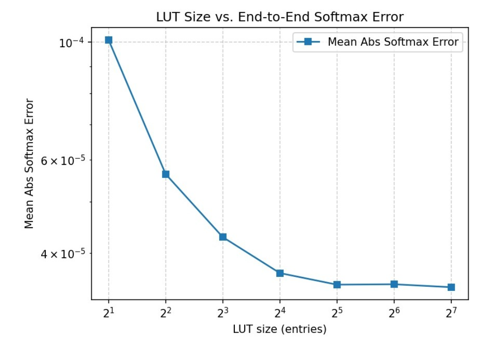
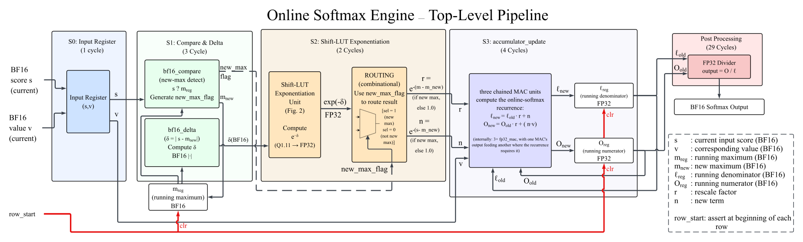
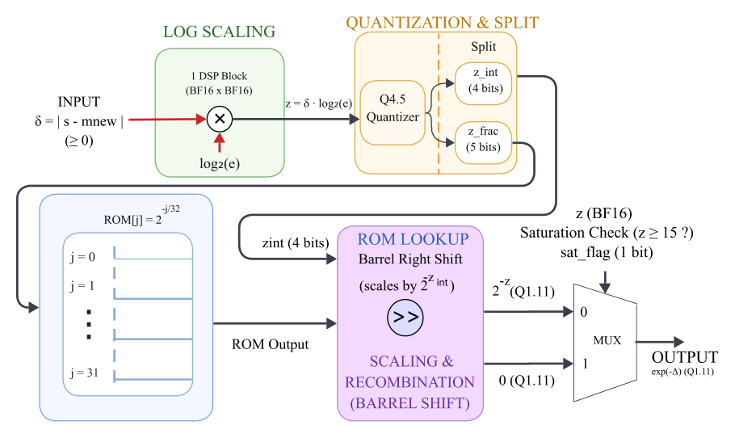
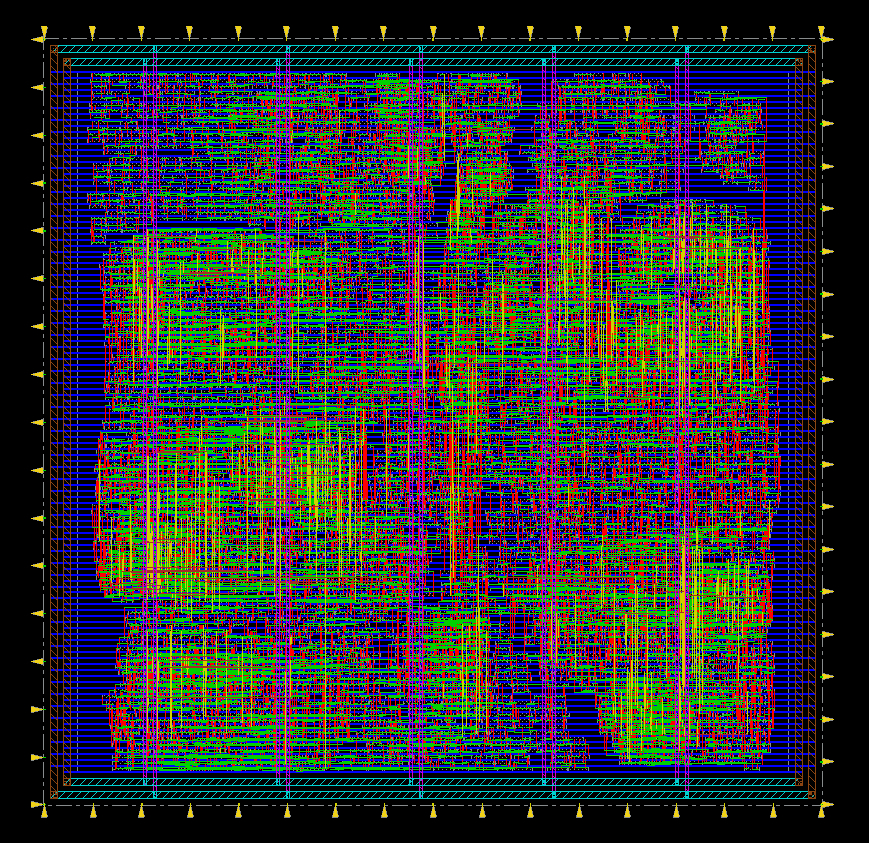
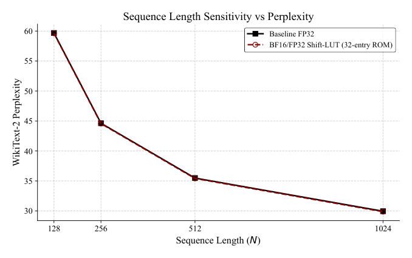
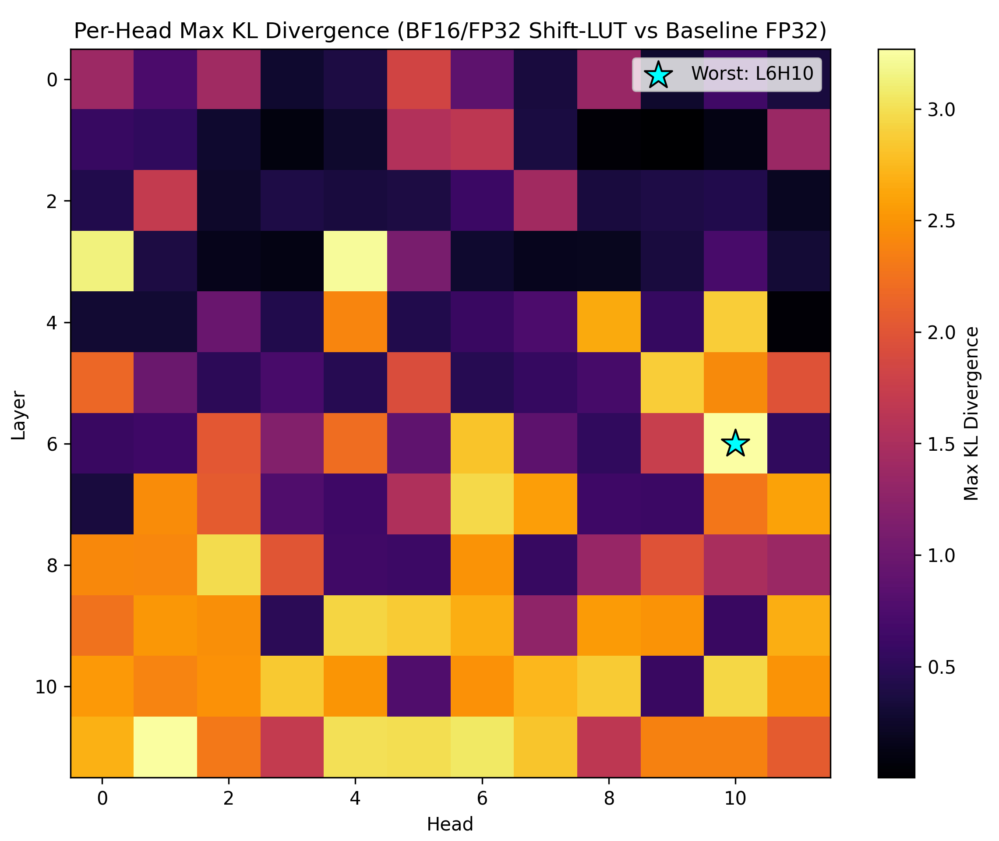

# A Hardware-Efficient Online Softmax Engine for FlashAttention using Base-2 Shift-LUT Exponentiation

[](LICENSE)
[]()
[]()
[]()

RTL, verification, FPGA, and ASIC implementation of a pipelined online-softmax engine that replaces iterative exponentiation with a Base-2 decomposition: a 32-entry ROM lookup and a barrel shift.

> **Paper:** *A Hardware-Efficient Online Softmax Engine for FlashAttention using Base-2 Shift-LUT Exponentiation*

## At a Glance

Compared with an iso-accuracy CORDIC baseline (14 iterations) in the same pipeline, post-route:

| | ASIC (UMC 65 nm) | FPGA (Spartan-7) |
|---|---|---|
| Exponential unit | **18.7× smaller** (671 vs 12,572 µm²) | **13.2× fewer LUTs** (56 vs 738) |
| Total area | **27.9% smaller** | **22.8% fewer LUTs** |
| Total power | **24.8% lower** | **10.3% lower** |
| F<sub>max</sub> | Equal (~154.5 MHz, both limited by the shared accumulator) | **6.4% higher** (107.64 vs 101.21 MHz) |
| Model quality | GPT-2 / WikiText-2 perplexity within 0.3% of FP32, top-1 token agreement unchanged | |

---

## Table of Contents

- [Motivation](#motivation)
- [Key Idea](#key-idea)
- [Architecture](#architecture)
- [Numeric Formats and Design Choices](#numeric-formats-and-design-choices)
- [Repository Structure](#repository-structure)
- [Getting Started](#getting-started)
- [Implementation Flows](#implementation-flows)
- [Verification](#verification)
- [Results](#results)
- [Discussion and Limitations](#discussion-and-limitations)
- [Contributions](#contributions)
- [Citation](#citation)
- [License](#license)

---

## Motivation

FlashAttention reformulates softmax as an online recurrence that updates a running maximum, a running denominator, and a running weighted output for every incoming attention score. The exponential evaluation therefore sits directly on the per-score datapath.

Existing hardware implementations typically rely on hyperbolic CORDIC, polynomial approximation, or piecewise-linear approximation. All three trade area, power, or latency for accuracy, and CORDIC in particular introduces iterative refinement in a stage that is executed once per score.

Most other stages of the recurrence (compare, subtract, multiply-accumulate, divide) have no meaningful design space. The exponential is the one stage where the architecture choice changes area, power, and timing, so this work isolates it as an interchangeable pipeline stage and asks whether it can be computed **without iteration**.

## Key Idea

Because the online recurrence always subtracts the running maximum, the exponent is bounded and non-positive. This permits an exact change of base:

$$e^{-\delta} = 2^{-\delta \log_2 e}, \qquad \delta \ge 0$$

Writing the scaled exponent as an integer and fractional part, $z = \delta \log_2 e = k + f$, gives

$$2^{-z} = 2^{-k} \cdot 2^{-f}$$

| Component | Hardware |
|---|---|
| Integer part $2^{-k}$ | Exact barrel right-shift |
| Fractional part $2^{-f}$, $f \in [0, 1)$ | 32-entry ROM lookup |

No iterative refinement and no general-purpose multiplier sit on the exponentiation path. The identity is exact; the only approximation is the quantization of the fractional term in the ROM.

### Choosing the LUT size

The ROM size was chosen from an end-to-end ablation sweep of 2 to 128 entries, measuring the mean absolute error of the final softmax outputs against a `torch.softmax` reference.

<p align="center">
  
</p>

Error falls steeply up to 16 entries and plateaus at 32 entries (mean absolute error 3.5×10⁻⁵, maximum 0.00978). Larger tables add area without improving accuracy, so 32 entries is the knee of the curve. It also maps directly onto the 5 fractional bits of the Q4.5 exponent. The plateau holds for both random score batches and end-to-end model evaluation.

---

## Architecture

The engine is a four-stage pipeline with a BF16 (score, value) input interface and FP32 internal accumulation, followed by an FP32 divider on row completion.

<p align="center">
  
</p>

| Stage | Module(s) | Latency | Function |
|---|---|---|---|
| S0 | Input register | 1 cycle | Register the BF16 (score, value) pair |
| S1 | `bf16_compare` ∥ `bf16_delta` | 3 cycles | Detect a new maximum; compute δ = \|s − m<sub>new</sub>\| |
| S2 | `shift_lut_exp` + routing | 2 cycles | Compute e<sup>−δ</sup> and route it to *r* or *n* |
| S3 | `accumulator_update` (3× `fp32_mac`) | 4 cycles | Update the running denominator and numerator |
| Post | `fp_div_synth` | 29 cycles | Output = O / ℓ, once per row |

A `row_start` signal clears the running registers at the start of each attention row. The control FSM issues one score per full S1–S3 latency, which keeps accumulator hazard handling simple at the cost of throughput (see [Limitations](#discussion-and-limitations)).

### Online softmax recurrence in hardware

For each score *s* with value *v*, the engine maintains the running maximum *m*, denominator ℓ, and numerator O:

$$m_{new} = \max(m, s), \quad r = e^{\,m - m_{new}}, \quad n = e^{\,s - m_{new}}$$

$$\ell_{new} = \ell_{old} \cdot r + n, \qquad O_{new} = O_{old} \cdot r + n \cdot v$$

Only one exponential is needed per score. If *s* is a new maximum, *n* = 1 and *r* = e<sup>−δ</sup>; otherwise *r* = 1 and *n* = e<sup>−δ</sup>. S1 produces δ and a `new_max_flag`, and the routing logic in S2 steers the single exponential result to *r* or *n*.

`accumulator_update` instantiates three `fp32_mac` units, each computing round(a·b) + c as a 4-stage pipeline (multiply → align → add/normalize → round/pack):

- `u_mac_l`: ℓ<sub>new</sub> = ℓ<sub>old</sub> · r + n
- `u_mac_nval`: n · v
- `u_mac_o`: O<sub>new</sub> = O<sub>old</sub> · r + (n · v)

Matched delay registers align ℓ<sub>new</sub> and O<sub>new</sub>, because O<sub>new</sub> needs the n · v result first.

### Stage S2: Shift-LUT exponentiation unit

<p align="center">
  
</p>

1. **Base change.** z = δ · log₂e with a single BF16 multiply (one DSP / multiplier).
2. **Saturation.** z ≥ 15 is forced to zero (e<sup>−15</sup> < 3×10⁻⁷, negligible for softmax); z = 0 maps to 1.0.
3. **Fixed-point conversion.** BF16 → Q4.5 with a single barrel shift, using direct field alignment instead of a general float-to-fixed converter.
4. **Split and lookup.** The 4-bit integer part `z_int` (0–15) becomes the shift amount; the 5-bit fraction `z_frac` (0–31) indexes a 32-entry, 12-bit ROM storing round(2<sup>−i/32</sup> · 2048) in Q1.11.
5. **Scaling shift.** `rom[z_frac] >> z_int` = 2<sup>−z</sup> · 2048, i.e. e<sup>−δ</sup> in Q1.11, converted to FP32 for the accumulator.

---

## Numeric Formats and Design Choices

| Where | Format | Why |
|---|---|---|
| Input / output interface | BF16 | Standard in Transformer accelerators; keeps FP32's 8-bit exponent (range matters more than mantissa for attention scores) at half the width |
| Running ℓ and O | FP32 | Repeated rescaling and accumulation would accumulate rounding error in reduced precision |
| Exponent z | Q4.5 | 4 integer bits = shift amount, 5 fraction bits = ROM address |
| Exponential output | Q1.11 | Enough precision that output quantization stays below the LUT error, without the cost of Q1.15 |

- **LUT over polynomial approximation.** A minimax or piecewise-linear evaluator needs repeated multiply-accumulates on the per-score path; a 32-entry ROM is a small fixed cost.
- **Barrel shift over a multiplier for 2<sup>−k</sup>.** A power-of-two scale is exact as a shift; a multiplier would add area, power, and delay with no precision gain. The novelty is the base-2 reformulation that makes the shift possible.

---

## Repository Structure

```
.
├── rtl/
│   ├── bf16_compare/            # Running-maximum comparison
│   ├── bf16_delta/              # Delta generation
│   ├── shift_lut_exp/           # Base-2 Shift-LUT exponential unit
│   ├── fp32_mac/                # FP32 multiply-accumulate
│   ├── accumulator_update/      # Online recurrence update
│   ├── fp_div_synth/            # Synthesizable FP32 divider
│   └── softmax_engine_top/      # Top-level integration
│
├── python/
│   ├── softmax_kernel_golden_reference.py
│   └── evaluation.py
│
├── fpga/                        # Vivado project and constraints
├── asic/                        # Genus / Innovus scripts
├── docs/                        # Figures used in this README
├── LICENSE
└── README.md
```

---

## Getting Started

### Prerequisites

| Purpose | Tool |
|---|---|
| Simulation | Any SystemVerilog-2012 simulator (Verilator, Questa, Xcelium) |
| FPGA | Xilinx Vivado |
| ASIC | Cadence Genus, Innovus, Voltus |
| Evaluation | Python 3.8+, NumPy, PyTorch, Transformers, Datasets |

### Running the Python evaluation

`evaluation.py` imports `softmax_kernel_golden_reference.py`, so both files must sit in the same directory.

```bash
cd python/
python evaluation.py       # or: python3 evaluation.py
```

This runs functional verification, error analysis, and the full accuracy sweep, and reproduces the metrics reported in the paper.

---

## Implementation Flows

Both the Shift-LUT and CORDIC designs go through matched flows on each target, so the only difference between builds is the S2 exponential unit. Both targets use a **100 MHz (10 ns) clock constraint**, and the CORDIC baseline is fixed at **14 iterations** (iso-accuracy).

### FPGA: Xilinx Spartan-7 (Vivado)

- Device: `xc7s50-csga324-1`.
- The accumulator and divider use Vivado floating-point IP (`fp_add`, `fp_mult`, `fp_div`).
- The baseline pipeline closed timing at WNS +0.200 ns with zero failing endpoints across 5,053 timing endpoints, before moving to ASIC.
- Synthesis, implementation, timing, utilization, and power reports are included.

### ASIC: UMC 65 nm (Cadence)

- Library: `uk65lscllmvbbr_120c25_tc` (typical corner).
- The Xilinx floating-point IP is not portable to a standard-cell flow, so it was rewritten as vendor-independent SystemVerilog (`fp32_mac.sv`, `fp_div_synth.sv`) and re-verified against the same golden model.
- Flow: synthesis in Genus; floorplanning, placement, CTS, and routing in Innovus; power analysis in Voltus. Signoff timing and power reports are included.

<p align="center">
  
</p>
<p align="center"><em>Post-route layout of the Shift-LUT engine (UMC 65 nm).</em></p>

> The UMC 65 nm standard-cell library is not distributed with this repository. A valid foundry/PDK licence is required to rerun the ASIC flow.

---

## Verification

The design is verified at three levels of abstraction.

**RTL.** The exponential unit was swept with ULP-tolerance checks in two campaigns (a 200-row sweep and an expanded 1,021-vector randomized sweep); all outputs stayed within the target ULP tolerance. The FP32 divider was verified separately against more than 300,000 randomized `numpy.float32` reference cases.

**Functional.** A bit-exact FP32/BF16 Python golden model is compared against RTL output, with waveform validation on mismatches. The same model re-verified the custom FP modules after the FPGA-to-ASIC migration.

**Algorithm.** A vectorized PyTorch model mirroring the RTL stage-for-stage replaces softmax in GPT-2, evaluated on WikiText-2 at sequence lengths N = 128 to 1024, measuring perplexity, top-1 token agreement, and per-head KL divergence against the FP32 baseline.

---

## Results

All comparisons are post-implementation against the iso-accuracy CORDIC-14 version of the same pipeline.

### ASIC: UMC 65 nm (typical corner, 100 MHz, post-route)

**Area**

| Metric | Shift-LUT | CORDIC (N = 14) | Improvement |
|---|---|---|---|
| Total area | 29,561.4 µm² (6,491 cells) | 40,973.4 µm² (8,454 cells) | 27.9% smaller |
| Exponential unit | 671.0 µm² (228 cells) | 12,571.9 µm² (2,265 cells) | 18.7× smaller |
| Accumulator (shared) | 19,604.2 µm² (4,356 cells) | 19,574.6 µm² (4,345 cells) | ~equal |

**Power**

| Metric | Shift-LUT | CORDIC (N = 14) |
|---|---|---|
| Total power | 4.241 mW | 5.636 mW (Shift-LUT 24.8% lower) |
| Internal | 2.700 mW (63.7%) | 3.744 mW (66.4%) |
| Switching | 1.538 mW (36.3%) | 1.889 mW (33.5%) |
| Leakage | 0.00232 mW | 0.00326 mW |
| Clock tree | 0.351 mW (8.29%) | 0.545 mW (9.67%) |

**Timing (10 ns target)**

| Metric | Shift-LUT | CORDIC (N = 14) |
|---|---|---|
| Worst setup slack | +3.529 ns | +3.530 ns |
| Data path delay | 6.278 ns | 6.280 ns |
| Implied F<sub>max</sub> | ~154.53 MHz | ~154.56 MHz |

**Critical path.** In both builds the critical path runs through the carry chain of `u_accum/u_mac_l`: it starts at adjacent bits of the shifted-extension register (`shifted_ext_s2_reg`) and feeds the same 23-stage adder/incrementer. Neither exponential unit is on the ASIC critical path, so the S2 choice affects area and power but not F<sub>max</sub> at this node and pipeline depth.

### FPGA: Spartan-7 (`xc7s50-csga324-1`)

**Resources**

| Metric | Shift-LUT | CORDIC (N = 14) |
|---|---|---|
| Slice LUTs | 2,050 | 2,656 |
| Slice registers | 3,491 | 4,186 |
| Slices | 828 | 985 |
| DSPs | 11 | 11 |
| Exponential unit LUTs | 56 | 738 (13.2× more) |
| Exponential unit registers | 13 | 713 (54.8× more) |

**Power**

| Metric | Shift-LUT | CORDIC (N = 14) |
|---|---|---|
| Total on-chip power | 0.139 W | 0.155 W (Shift-LUT 10.3% lower) |
| Dynamic | 0.069 W (50%) | 0.084 W (54%) |
| Device static | 0.070 W (50%) | 0.070 W (46%) |
| Exponential unit | 0.002 W (1% of total) | 0.022 W (14% of total) |

**Timing**

| Metric | Shift-LUT | CORDIC (N = 14) |
|---|---|---|
| WNS (100 MHz) | +0.710 ns | +0.120 ns |
| Worst hold slack | +0.019 ns | +0.022 ns |
| F<sub>max</sub> | 107.64 MHz | 101.21 MHz |
| Logic depth | 8 levels | 9 levels |
| Critical path cells | 1× DSP48E1, 1× LUT2, 1× LUT5, 5× LUT6 | 5× CARRY4, 1× DSP48E1, 2× LUT2, 1× LUT3 |
| Logic / routing delay | 50.6% / 49.4% | 66.2% / 33.8% |

On FPGA the critical paths differ. Shift-LUT's path runs from the delta computation to the exponential output. CORDIC-14's path is logic-dominated and sits entirely inside its own late iteration stages, which is what costs it 6.4% in F<sub>max</sub>.

### Overall PPA (CORDIC-14 = 1.00×)

| Metric | ASIC | FPGA |
|---|---|---|
| Exponential unit area / LUTs | 0.053× (18.7× smaller) | 0.076× (13.2× fewer LUTs) |
| Total area / LUTs | 0.722× (27.9% smaller) | 0.772× (22.8% fewer LUTs) |
| Total power | 0.752× (24.8% lower) | 0.897× (10.3% lower) |
| F<sub>max</sub> | 1.000× (~equal) | 1.064× (6.4% higher) |

### Numerical accuracy

- **Exponential unit vs. true e<sup>−x</sup>:** maximum relative error ~1.5%, mean ~0.8%, over δ ∈ [0, 6]. Beyond δ ≈ 7.6 the Q1.11 output clamps, and relative error against vanishingly small true values is no longer meaningful.
- **Perplexity:** GPT-2 / WikiText-2 perplexity stays within 0.3% of the FP32 baseline across N = 128 to 1024; the curves are visually indistinguishable.
- **Top-1 token agreement:** unchanged.
- **KL divergence:** low on average (mean 0.204 nats per head across 144 layer-head pairs). A few heads are higher (worst: layer 6, head 10, at 3.27 nats); these are near-one-hot attention distributions, where a fixed relative error inflates KL without affecting model output.

<p align="center">
  
  
</p>

---

## Discussion and Limitations

**When to use Shift-LUT vs. CORDIC.** Shift-LUT fits when the exponent range is bounded and known in advance, as in FlashAttention where scores are pre-shifted by the running maximum. CORDIC remains the better choice for wide or unknown input ranges, or when accuracy must be adjustable at runtime or after fabrication.

**FPGA vs. ASIC.** The area and power advantage holds on both platforms. The timing advantage is FPGA-specific: ASIC synthesis absorbs CORDIC's 14 iterations into a carry-chain path no worse than the shared accumulator, while fixed FPGA LUT/CARRY4 primitives cannot restructure it as efficiently.

**Limitations**

1. The head dimension is processed as a single scalar lane; multi-head throughput scales by instantiating more engines rather than a wider datapath.
2. One running maximum and running sum are in flight with no forwarding, so the FSM issues one score per S1–S3 latency and back-to-back tiles cannot overlap accumulator updates.
3. Inference only: there is no softmax-Jacobian datapath for the backward pass.

**Future work.** Vectorizing the datapath across the head dimension, overlapping accumulations across tiles, and evaluating Shift-LUT in a training pipeline.

---

## Contributions

1. An online-softmax hardware pipeline (compare, delta, exponential, FP32-accumulated update) built to isolate the exponential unit as an interchangeable stage.
2. A base-2 Shift-LUT exponential unit that replaces iterative rotation with a 32-entry ROM lookup and a barrel shift.
3. A verification methodology spanning a bit-exact Python golden model, ULP-tolerance randomized sweeps, and GPT-2 / WikiText-2 evaluation, applied identically to FPGA and ASIC builds.
4. A post-implementation PPA comparison against an iso-accuracy CORDIC baseline, showing CORDIC's iterative structure becomes a timing bottleneck on FPGA but is absorbed by ASIC synthesis.
5. The full flow released from RTL through FPGA and ASIC signoff.

---

## Citation

```bibtex
@inproceedings{shiftlut_softmax,
  title     = {A Hardware-Efficient Online Softmax Engine for FlashAttention
               using Base-2 Shift-LUT Exponentiation},
  author    = {Bharat Kumar, Harshit Krishna, Prof. Madhav Rao},
  year      = {2026}
}
```

---

## License

Released under the MIT License. See [LICENSE](LICENSE) for the full text.
